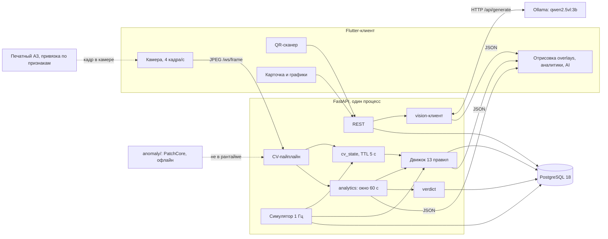
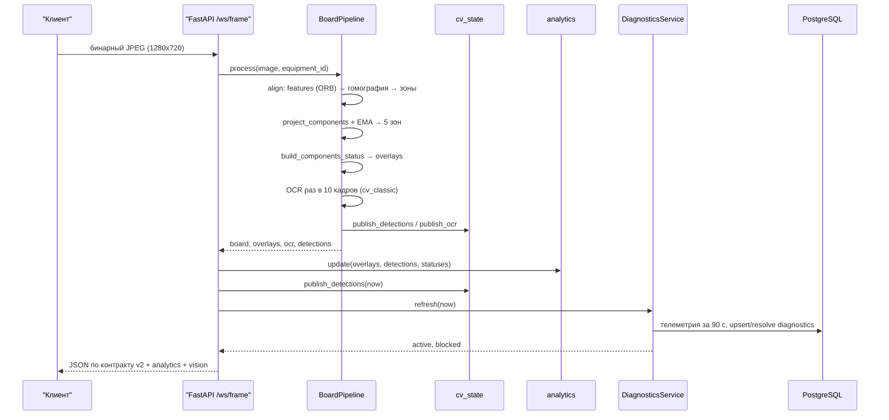
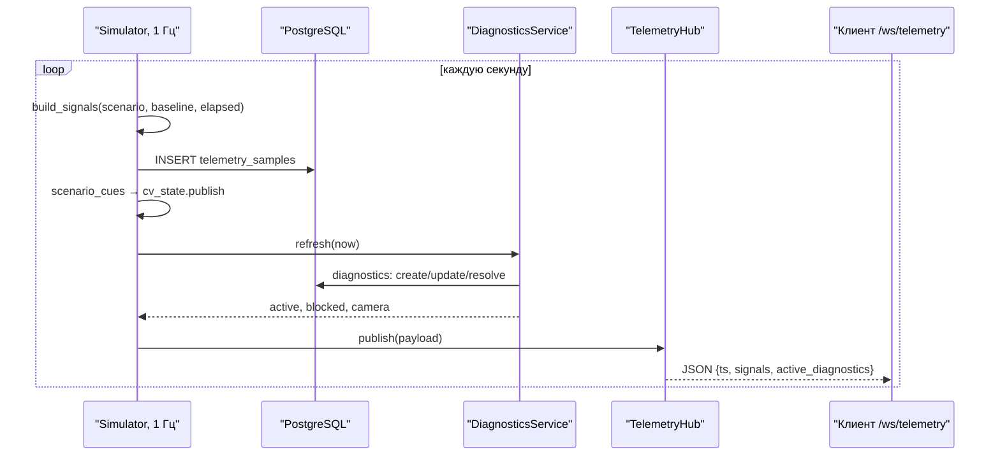
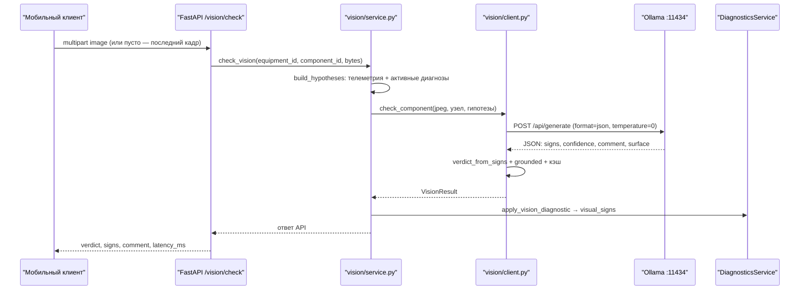

# Архитектура

Документ описывает, как устроен прототип, какие компоненты за что отвечают и
почему выбраны такие решения. Источник истины по полям ответа — `docs/contract.md`,
по мотивации — `docs/limitations.md`. Здесь — инженерная картина целиком.

Версия backend: 0.4.0. Один процесс uvicorn; состояние CV, окно видеоаналитики
и симулятор — в памяти процесса, история — в PostgreSQL 18 (SQLite — резерв для
тестов). Локальная VLM работает отдельным процессом Ollama. Детектор аномалий
`anomaly/v2` подключён визуальным каналом на CPU (`ANOMALY_DEVICE=cpu`), а
публичный PatchCore `anomaly/public/` остаётся офлайн-модулем оценки.

---

## 1. Компоненты

| Компонент | Код | Ответственность | Чего не делает |
|---|---|---|---|
| Flutter-клиент | `mobile/` | QR-идентификация, карточка агрегата, камера, отправка JPEG, отрисовка оверлеев, OCR, панели аналитики и AI-проверки, формы, история, настройка адреса | не считает геометрию, OCR, правила и `verdict`; не хранит историю |
| FastAPI | `backend/app/main.py` | REST, два WebSocket, CORS, жизненный цикл, сборка ответов | не хранит состояние вне процесса, кроме БД |
| AR-модуль | `ar_board/` | планшеты без ArUco: привязка по признакам сцены (`ALIGN_MODE=features`, эталоны `references.json`), полигоны зон из `layout.json` (5 в `out_real`, 4 в `out_defect`), EMA-сглаживание, горячая подмена layout; маркерный режим (`DICT_4X4_50`, id 0–3) — резервный fallback | не знает про дефекты и датчики |
| CV-пайплайн | `backend/app/cv/pipeline.py` | кадр → поза → зоны → детекции → статусы → оверлеи → OCR → `cv_state` | не пишет кадры в БД |
| OCR манометра | `cv_classic/` | чтение стрелочного прибора классическим CV; калибровка за 3 клика | не обучается, не работает по нейросети |
| Эвристики дефектов | `cv_classic/defects.py` | коррозия/масло/окисление по ROI узла | включены (`CV_DEFECTS=true`); флаг — только ручной выключатель для отладки |
| Видеоаналитика | `backend/app/analytics.py` | скользящее окно 60 с, поузловая видимость, подтверждение дефектов, компактный и полный отчёт | не хранит кадры; окно живёт в памяти |
| Итог осмотра | `backend/app/verdict.py` | `verdict` из 4 статусов по окну и составу узлов | не превращает нехватку данных в «норму» |
| Vision-канал | `backend/app/vision/` | локальная VLM: проверка узла, заключение по фактам, статус Ollama, кэш | не заменяет правила и не ставит окончательный диагноз |
| Движок правил | `backend/app/diagnostics/` | 13 правил из YAML, `evidence`, confidence, гистерезис, дедупликация, запись событий | не содержит порогов в коде |
| Симулятор | `backend/app/simulator.py` | телеметрия 1 Гц, 11 сценариев, CV-подсказки, WS-hub, очистка истории | не является драйвером реальных датчиков |
| Хранилище | `backend/app/models.py`, `db.py` | карточки, узлы, осмотры, телеметрия, диагностика, регламент, сценарий | не хранит поток кадров |
| Детектор аномалий | `anomaly/` | anomaly/v2 PatchCore: обучение только на норме, score и heatmap; подключён визуальным каналом на CPU. `anomaly/public/` — офлайн-оценка на MVTec AD | не классифицирует тип дефекта; публичный PatchCore в API не подключён |
| ML-заготовка | `ml/` | план датасета, разметка, `train.py` YOLO11, экспорт ONNX | весов и датасета в поставке нет |
| Бенчмарк | `benchmark/` | VLM против эвристик на GC10-DET и своих кадрах | не входит в рантайм |

Клиент — тонкий сознательно: сервер можно менять (разметка, модель, пороги) без
обновления APK. Обратная сторона — без сети телефон не работает; это принято,
см. `docs/limitations.md`.



---

## 2. Потоки данных

### 2.1. Кадр → оверлеи → диагноз



Окно `analytics` обновляется **до** пересчёта правил: `visual_defect` и
`visual_signs` учитывают стабильность дефекта в окне, а не только текущий кадр.

Шаги и точные пороги:

1. **Привязка.** По умолчанию `ALIGN_MODE=features`: `VisualBoardRegistry`
   матчит кадр с эталонами `ar_board/references.json` (ORB по пирамиде
   масштабов, RANSAC-гомография), при слабом совпадении — fallback по контуру
   листа. Маркерный режим (`ALIGN_MODE=aruco`) требует ≥3 маркеров из
   `layout.json`, ошибка репроекции ≤6 px, покрытие ≥2 % кадра; гомография —
   `findHomography` (RANSAC, порог 3 px), `solvePnP` — для `rvec/tvec`.
   `board.method` в ответе: `features` или `homography+pnp`.
2. **Поза → зоны.** `project_components` переносит `polygon_px` планшета в
   координаты кадра. `Smoother(alpha=0.35)` сглаживает углы по EMA и сбрасывается
   после ~1 с без детекции. Для каждой зоны считается `visible` и `area_px`.
3. **Уверенность планшета.** `q_reproj = clamp(1 − err/6)`,
   `q_coverage = clamp(coverage/0.30)`,
   `confidence = clamp(0.90 + 0.05·q_reproj + 0.03·q_coverage, 0, 0.98)`.
   То есть «планшет найден» — всегда 0.90–0.98, а не 1.0.
4. **Детекции.** Видимые зоны дают `Detection(kind="component", source="board")`
   с нормализованным bbox. `build_components_status` считает статус:
   `possible_defect` при дефекте ≥0.60, `check_required` ≥0.35, иначе `ok` при
   уверенности узла ≥0.50; нет узла — `insufficient_data`.
5. **Оверлеи.** Клиент получает готовые `polygon` в пикселях,
   `status`/`color` (`ok→green`, `check_required→yellow`,
   `possible_defect→red`, `insufficient_data→grey`), `label`, `defects`.
6. **OCR.** ROI манометра — квадрат 512×512 в координатах планшета (margin 1.30
   вокруг зоны), переносится в кадр матрицей `M_roi · H⁻¹`. Читается каждый
   `GAUGE_OCR_EVERY`-й кадр (10 по умолчанию), между чтениями отдаётся кэш с
   `refreshed=false` и `age_frames`. Значение публикуется в `cv_state` с TTL 5 с.
7. **Свежесть.** `cv_state.snapshot` отдаёт `available=false`, если последний
   кадр старше `CV_TTL_SEC` (5 с). Это основа `blocked_by: camera_unavailable`
   и `ocr_unavailable`; уже выданное предупреждение при потере камеры не
   снимается (fail-safe).
8. **Правила.** `DiagnosticsService.refresh` берёт последние 90 с телеметрии
   (`limit` 600), подставляет OCR (приоритеты ниже), оценивает 13 правил,
   применяет гистерезис и возвращает `active`, `history` (50 последних
   закрытых), `blocked`.

**Приоритет источника `manometer_ocr`** (`service._with_ocr`):

1. `manometer_ocr` в самом свежем сэмпле телеметрии (сценарий `gauge_drift`);
2. `manometer_ocr` не старше `CV_TTL_SEC` в предыдущих сэмплах (сигнал может
   приходить реже телеметрии; граница поднимается на 1 с от `started_at`
   сценария, чтобы значение прошлого сценария не «протекало»);
3. свежее OCR с камеры из `cv_state` (не `stale`);
4. иначе правило `gauge_drift` → `blocked_by: ocr_unavailable`.

### 2.2. Телеметрия → правила → БД → клиент



Раз в 60 тиков симулятор обновляет `equipment.runtime_hours` и вызывает
`cleanup_telemetry` (по умолчанию хранит 180 минут, `TELEMETRY_RETENTION_MIN`,
0 — не чистить). Очередь подписчика — максимум 10 сообщений: при отставании
клиента старые кадры телеметрии вытесняются, новые не теряются.

### 2.3. Осмотр → БД

`POST /inspections`:

1. проверяет `class_id`/`class_name`/`kind` и bbox 0..1 (`schemas.py`);
2. считает статусы узлов по детекциям и сводит их с подтверждёнными
   признаками окна `analytics` (коррозия/аномалия приходят в `signs`, а не в
   `detections`); для каждого видимого узла берётся худший статус;
3. делает снимок активной диагностики (`refresh`);
4. берёт полную сводку окна `analytics.summary` и считает `verdict`
   (`build_verdict`);
5. атомарно пишет `inspections` (`summary_json`, `diagnostics_json`,
   `analytics_json`), `inspection_detections` (`bbox_json`);
6. обновляет `components.condition` для **каждого видимого** узла:
   `possible_defect`/`check_required` — как есть, чистый видимый — `ok`;
   невидимый узел (`insufficient_data`) пропускается, чтобы не затирать
   историю состояния.

`verdict` дублируется в `summary_json` и в ответе; `GET /inspections` отдаёт
`analytics` и `verdict` для каждого осмотра (для старых записей вердикт
пересчитывается на лету из сохранённой сводки).

Остаточный ресурс в ответе карточки считается на лету и в БД не хранится.

---

## 3. Модель данных

SQLAlchemy 2.0, переносимо между PostgreSQL и SQLite: `JsonType` =
`JSON().with_variant(JSONB(), "postgresql")`. Схема создаётся идемпотентно
(`init_db`), сид — `seed_all` из `backend/data/seed_rig.json`. В демо два
агрегата: `PUMP-001` (исправный) и `PUMP-002` (дефектный участок), по 5 узлов
у каждого; QR-коды — `ar_board/qr/PUMP-001.png` и `PUMP-002.png`.

| Таблица | Ключевые поля | Назначение |
|---|---|---|
| `equipment` | `id` PK, `name`, `model`, `serial`, `year`, `runtime_hours`, `normative_life_years`, `last_service_date`, `qr_code`, `location`, `baseline_json` | паспорт агрегата и нормы сигналов |
| `components` | `id` PK, `equipment_id` FK, `name`, `kind`, `normative_life_years`, `installed_date`, `condition`; unique `(equipment_id, name)` | узлы: motor, pump, coupling_guard, flange, manometer |
| `inspections` | `id`, `equipment_id`, `created_at`, `summary_json`, `diagnostics_json`, `analytics_json` | сохранённый осмотр, снимок диагнозов, окна и `verdict` |
| `inspection_detections` | `id`, `inspection_id`, `class_name`, `kind`, `confidence`, `component_id`, `bbox_json` | детекции осмотра |
| `telemetry_samples` | `id`, `equipment_id`, `ts`, `payload`, `scenario` | сырые сэмплы 1 Гц |
| `diagnostics` | `id`, `equipment_id`, `rule_id`, `severity`, `status`, `confidence`, `evidence`, `message`, `recommendation`, `overlay`, `created_at`, `updated_at`, `resolved_at` | события правил |
| `maintenance_intervals` | `id`, `equipment_id`, `interval_hours`, `name`, `description`; unique `(equipment_id, interval_hours)` | регламент ТО-1/ТО-2/ТО-3 |
| `scenario_state` | `equipment_id` PK, `scenario`, `started_at` | текущий сценарий, переживает рестарт |

Статусы диагностики: `active → acknowledged → resolved`. Частичный уникальный
индекс `ux_diagnostics_open_rule (equipment_id, rule_id) WHERE status <> 'resolved'`
держит не более одного открытого события на правило, не мешая истории.

Индексы: `ix_telemetry_equipment_ts (equipment_id, ts DESC)` для окон и графиков;
`ix_diagnostics_equipment_status`, `ix_diagnostics_equipment_created`;
`ix_components_equipment`, `ix_inspections_equipment`, `ix_detections_inspection`;
GIN `jsonb_path_ops` по `telemetry_samples.payload` и `diagnostics.evidence`.

### Почему JSONB

* `telemetry_samples.payload` — 17 разнородных сигналов (плюс `manometer_ocr`
  в сценарии `gauge_drift`) одним объектом;
  добавление датчика не требует миграции, числа и строки (`oil_color`) лежат
  вместе, поиск по содержимому — `payload @> '{"oil_color":"dark"}'`.
* `diagnostics.evidence` — объяснение срабатывания: условие, факт, норма, порог,
  вес, score. Структура меняется вместе с правилами, но должна оставаться
  машиночитаемой; GIN позволяет искать события по конкретному условию.
* `overlay` и `bbox` — переменная структура (маркер, цвет, координаты).
* Цена: нет типизации и constraint-ов на отдельные сигналы; валидация — в
  приложении и pydantic-схемах, а не в БД.

---

## 4. Формат правил

Каталог — данные, не код: `backend/rules/rules.yaml` (13 правил, `version: "1.1"`).
Загрузчик валидирует YAML pydantic-схемой и кэширует по mtime: правка
подхватывается без перезапуска. Глобально пороги можно переопределить
`RULE_ACTIVATE_CONFIDENCE` / `RULE_RELEASE_CONFIDENCE`.

```yaml
version: "1.0"
activate_confidence: 0.65
release_confidence: 0.45
rules:
  - id: gauge_drift
    title: "Расхождение показаний манометра"
    severity: warning            # critical | warning | info
    tags: [ocr, pressure, metrology]
    dedupe_group: null           # общий ключ для взаимного подавления
    specificity: 0               # больше — приоритетнее внутри группы
    latch_sec: 0                 # ≥0: сколько держать событие после активации
    message: "..."
    recommendation: "..."
    overlay: {component_id: manometer, marker: badge, color: orange, label: "Поверка манометра"}
    conditions:
      - signal: manometer_ocr
        op: deviation_pct
        ref: pressure_outlet
        value: 15
        weight: 1
```

Поля условия: `signal`, `op`, `value` | `values`, `ref`, `factor`,
`window_sec`, `weight`, `optional`, `alternatives`, `cv_class`,
`min_confidence`, `component_id`, `description`. `ref` — `baseline.<signal>` из
карточки или имя другого сигнала; `factor` — множитель к `ref`. `optional: true`
означает «нет сигнала — условие не блокирует правило» (шум, расход); остальные
отсутствующие сигналы дают `blocked_by`.

### Операторы

| `op` | Смысл | `actual` / `threshold` в evidence |
|---|---|---|
| `gt`, `lt`, `gte`, `lte` | сравнение с порогом | значение сигнала / порог (`value` или `factor × ref`) |
| `trend_up`, `trend_down` | наклон линейной регрессии по окну, единица/с | наклон / ±минимальный наклон |
| `crosses` | переход порога снизу вверх внутри окна | порог, который пересекли |
| `unbalance_pct` | `(max − min)/mean × 100` по группе фаз (`current` → a/b/c) | дисбаланс, % / порог |
| `deviation_pct` | `|signal − ref| / |ref| × 100` | отклонение, % / порог |
| `in` | значение входит в список | значение / список |
| `has_signal` | сигнал присутствует | значение / null |
| `cv` | свежее CV-наблюдение класса с `confidence ≥ min_confidence` (опционально на узле) | confidence детекции / порог |
| `any` | ИЛИ по `alternatives`; берётся лучший совпавший вариант | как у выбранного варианта |

Тренд требует ≥5 точек и ≥60 % окна; наклон нормирован на секунду, поэтому
порог не зависит от длины окна. `crosses` используется для наработки
4000/8000/16000 м/ч в окне 60 с.

### Confidence, гистерезис, дедупликация

```
confidence = clamp( (Σ w_i·m_i / Σ w_i) × (0.5 + 0.5·mean(e_i)), 0, 1 )
```

* `m_i = 1`, если условие совпало; `w_i` — `weight` из YAML;
* для `gt/lt/gte/lte`: `e_i = clamp(|actual − threshold| / |threshold| / 0.2)`;
* для тренда: `e_i = clamp((|slope| / min_slope − 1) / 2)`;
* для `cv`: `e_i` = confidence детекции; для `crosses`/`in`/`any` — 1;
* множитель `0.5 + 0.5·mean(e)` не даёт сработать «ровно на пороге».

Активация при `confidence ≥ 0.65`, снятие при `< 0.45`; между порогами событие
удерживается. Сортировка: `critical > warning > info`, затем confidence.
В группе `dedupe_group` остаётся более специфичное правило; при равной
специфичности сравниваются severity и confidence. Проигравшее помечается
`suppressed_by` и закрывается.
`latch_sec` (у `maintenance_due` — 3600 с) не даёт событию исчезнуть на
следующем тике.

### Evidence

Каждое условие попадает в `evidence` — включая несовпавшие:

```json
{
  "condition": "|manometer_ocr − pressure_outlet| / |pressure_outlet| × 100 > 15 %",
  "signal": "manometer_ocr",
  "op": "deviation_pct",
  "actual": 21.9216,
  "baseline": 8.389,
  "threshold": 15.0,
  "matched": true,
  "weight": 1.0,
  "score": 1.0,
  "note": "manometer_ocr=6.55, pressure_outlet=8.389"
}
```

`baseline` — норма или второй сигнал сравнения, `threshold` — фактический порог
после `factor`, `score` — вклад в запас по порогу. Для CV в `note` — bbox и узел
или `no_fresh_detection`; для тренда `actual` — наклон. Это и есть объяснимость:
видно, какое условие сработало и с каким запасом.

### Блокировки

`blocked_diagnostics[]` отвечает, почему правило молчит:

| `blocked_by` | Когда |
|---|---|
| `camera_unavailable` | нет свежих кадров (TTL 5 с истёк) для CV-правила |
| `ocr_unavailable` | правилу нужен `manometer_ocr`, а значения нет |
| `signal_missing:<signal>` | в телеметрии нет обязательного сигнала (в т.ч. `ref_missing`) |
| `insufficient_window` | меньше 5 точек или <60 % окна для тренда |
| `no_telemetry` | нет ни одного сэмпла (отдельный случай, в контракте не перечислен) |

При блокировке `confidence = 0`: CV/OCR-правило не срабатывает по одним
датчикам. Если событие уже было выдано, потеря камеры его не снимает.

---

## 5. Остаточный ресурс

`backend/app/resource.py`:

```
remaining_years = max(0, normative_life_years − age_years) × condition_factor
age_years = (today − installed_date).days / 365.25
condition_factor: ok = 1.0, check_required = 0.7, possible_defect = 0.4
```

Ответ комплектующей в `GET /equipment/{id}`:

```json
{
  "value": 1.94,
  "status": "ok",
  "is_estimate": true,
  "basis": {
    "normative_life_years": 6.0,
    "installed_date": "2023-08-20",
    "condition": "check_required",
    "condition_factor": 0.7,
    "as_of": "2026-11-13",
    "formula": "max(0, normative_life_years - age_years) * condition_factor",
    "age_years": 3.23
  }
}
```

`status`: `ok` при `value > 0`, `exhausted` при 0, `insufficient_data` если нет
нормативного срока, даты или дата не `YYYY-MM-DD` (тогда `value=null`).

**Почему всегда `is_estimate: true`.** Нет датчиков износа и фактической
наработки по каждой комплектующей; `condition` — категория из последнего
осмотра, а не измерение; ресурс считается по календарному возрасту, а не по
режиму нагрузки. Это ориентир для планирования, а не нормативный расчёт, поэтому
флаг ставится и при нормальном расчёте, и при нехватке данных.

---

## 6. Почему такие решения

| Решение | Причина | Что отвергнуто |
|---|---|---|
| Тонкий клиент, весь inference на сервере | быстрая итерация, один язык для CV/правил/БД, клиент не зависит от модели | TFLite/ONNX на устройстве, Unity |
| Привязка по признакам сцены (`ALIGN_MODE=features`) + QR | работает без датасета и обучения, маркеры на планшете не нужны; маркерный ArUco остаётся fallback | SLAM/6DoF, ARCore, только маркерная привязка |
| Классическое CV для манометра | объяснимо и детерминированно, ~0.1 с на CPU, не нужен GPU | нейросетевой OCR |
| Правила как YAML | пороги меняются без правки кода; каталог показывается жюри | хардкод if-else |
| `evidence` в каждом событии | объяснимость и разбор инцидентов | только текст диагноза |
| PostgreSQL + JSONB | рекомендация организатора; гибкие сигналы, GIN, история | SQLite как основное хранилище |
| Симулятор со сценариями | физических датчиков нет; срабатывание правил видно в динамике | статичные числа |
| Визуальные каналы включены (`CV_DEFECTS=true`) | эвристики калиброваны по синтетике и подтверждаются окном; `CV_DEFECTS=false` — только ручной выключатель для отладки | держать выключенными на демо |
| `DETECTOR=board` по умолчанию | главный критерий — сквозной поток, а не заглушка | `fake` как основной режим |

Полные формулировки — `docs/contract.md`.

---

## 7. Границы реализации

* **YOLO.** `YoloDetector` — рабочая обёртка над `ultralytics`, но весов в
  репозитории нет, `ml/dataset` пуст, модель не обучена. Рабочий режим —
  `board`, отладочный — `fake`.
* **Эвристики дефектов** `cv_classic` реализованы и измерены на синтетике;
  включены по умолчанию (`CV_DEFECTS=true`) и работают на демо, порог берётся
  из `cv_classic/configs/defects.json`.
* **Один процесс.** Симулятор, гистерезис и `cv_state` живут в памяти uvicorn:
  несколько воркеров дадут разные ответы и дубли событий. Для масштабирования
  нужен внешний брокер/БД-блокировки.
* **Нет авторизации** и разграничения ролей; CORS открыт (`*`), сервер рассчитан
  на изолированную локальную сеть.
* **Нет пагинации** для `/inspections` и `/rules`; история диагностики
  ограничена 50 закрытыми событиями.
* **Поток кадров не архивируется**: в БД попадают только осмотры, а не каждый
  кадр.
* **`/ws/frame` и `/ws/telemetry` проверяют `equipment_id`** и закрывают
  соединение кодом `1008` (`unknown_equipment`). Это поведение появилось после
  версии 0.3.0: в старых сборках `/ws/frame` падал на `refresh`. См. `docs/api.md`.
* **Окно аналитики и VLM-кэш живут в памяти процесса.** Рестарт сервера
  обнуляет окно, историю AI-проверок и кэш ответов модели; в БД остаются только
  сохранённые осмотры с `analytics_json`.

---

## 8. Видеоаналитика: окно наблюдения

Один кадр не даёт оснований для вывода: эвристика может мигнуть на блике или
тени. Поэтому поверх покадрового пайплайна работает аккумулятор `app/analytics.py`
(по одному на `equipment_id`, `RLock`):

* скользящее окно `ANALYTICS_WINDOW_SEC` (**60 с**), агрегаты по секундным
  бакетам — сами кадры не хранятся;
* по узлу `visibility_ratio = frames_seen / frames_total`;
* по дефекту `presence_ratio = frames_present / frames_seen_component`,
  `mean_confidence`, `max_confidence`, `first_seen_at`/`last_seen_at`;
* подтверждение: `presence_ratio >= ANALYTICS_CONFIRM_RATIO` (**0.3**) и
  `frames_present >= ANALYTICS_CONFIRM_FRAMES` (**3 кадра**);
* записи старше окна вытесняются при каждом обновлении; сброс — `/sim/reset`,
  `/analytics/reset` и успешная смена layout (смена только флага `defects`
  окно не сбрасывает).

Обновление вызывается в общем обработчике кадра (`/ws/frame` и `/analyze`)
после пайплайна, до пересчёта правил. Компактный блок `analytics` уходит в
ответ кадра, полная сводка — в `GET /equipment/{id}/analytics`, снимок — в
`inspections.analytics_json`.

### Поузловые статусы

`status_window` считается по каждому узлу независимо — «не видел манометр» не
делает насос «недостаточным»:

| Условие | `status_window` | `note` |
|---|---|---|
| `frames_seen == 0` | `insufficient_data` | «узел не встречался в окне» |
| `last_seen_ago_sec > 5` (`COMPONENT_ABSENT_SEC`) | `insufficient_data` | «узел вне кадра N с» |
| есть подтверждённый дефект | `possible_defect` | «подтверждено: <классы>» |
| есть неподтверждённый дефект или `visibility_ratio < 0.5` | `check_required` | «не подтверждено: <классы>» / «низкая видимость» |
| иначе | `ok` | «виден N из M кадров» |

Порядок статусов в отчёте: `possible_defect` → `check_required` → `ok` →
`insufficient_data`. Узлы, не встречавшиеся в окне, не скрываются: клиент
показывает их серыми «не в кадре» и не подставляет значения.

Правила `visual_defect`/`visual_signs` используют окно для стабильности:
неподтверждённый одиночный дефект понижается до `info` («единичное наблюдение,
требуется повторная проверка»), а подтверждённый сохраняет `warning`/`critical`.
Это разделяет разовую помеху и устойчивый визуальный признак.

### Визуальные каналы и устройства

Все визуальные каналы включены по умолчанию: эвристики `cv_classic.defects`
(`CV_DEFECTS=true`), ONNX-коррозия (`CORROSION_ENABLED=true`), anomaly/v2
(`ANOMALY_ENABLED=true`) и проверка guard-маркера. GPU отдан VLM (Ollama),
поэтому модели CV считаются на CPU: `ANOMALY_DEVICE=cpu`,
`CORROSION_PROVIDERS=cpu`. `cuda` включается явно, если карта свободна.

---

## 9. Локальная vision-модель

VLM — **подтверждающий и объясняющий** канал, а не источник окончательного
диагноза. Работает полностью офлайн через Ollama (`OLLAMA_URL` по умолчанию
`http://127.0.0.1:11434`), модель `qwen2.5vl:3b` (Q4_K_M, ~3.8B).



### Как устроен вызов

1. **Кадр.** `POST /vision/check` принимает `multipart/form-data` с полем
   `image` (JPEG/PNG, ≤15 МБ) или, без файла, берёт последний кадр `/ws/frame`
   либо `/analyze`. Перед отправкой длинная сторона уменьшается до 1280 px,
   JPEG q90 — быстрее и стабильнее.
2. **Гипотезы.** В промпт добавляется строка «Датчики показывают: …; проверь,
   видны ли соответствующие визуальные признаки». Гипотезы собираются из
   последней телеметрии и активных диагностик; они не заменяют визуальный вывод.
3. **Схема ответа.** Строго четыре признака: `corrosion`, `paint_peeling`,
   `oil_leak`, `mechanical_damage`; значение `true` / `false` / `null`
   (`null` = «не видно / мало качества»).
4. **Вердикт.** Любой `true` → `defect`; все `false` → `no_defect`; иначе
   `insufficient`. Текстовый фолбэк: если признаков нет, но `confidence ≥ 0.7`
   и в комментарии есть «не видно / нет следов / отсутствует», ставится
   `no_defect` — иначе чистый узел на демо выглядел бы отказом.
5. **Grounded.** Если в комментарии есть числа, которых не было во входных
   данных (гипотезах), ответ не отбрасывается, а помечается `grounded=false`.
6. **Кэш.** Ключ — хэш изображения + узел, TTL 10 мин, до 128 записей; при
   попадании `cached=true`, `latency_ms=0`.
7. **Побочный эффект.** При `verdict=defect` создаётся диагностика
   `visual_signs` (severity `warning`) с `evidence` = признаки + confidence.
   Если по тому же узлу уже активно `visual_defect`, остаётся более уверенное,
   второе получает `suppressed_by` и уходит в историю.
8. **`GET /vision/explain`** не передаёт изображения: только факты
   (телеметрия, активные диагностики с evidence, последняя VLM-проверка,
   паспорт и остаточный ресурс). Модель не может занизить severity относительно
   фактов; при числе, которого нет в фактах, сервер подставляет
   детерминированное заключение и `error="ungrounded"`.

### Ограничения и деградация

| Ситуация | Поведение |
|---|---|
| `VISION_ENABLED=false` | вызовы модели не выполняются, API отвечает `error="vision_disabled"` |
| Ollama не запущена | `error="ollama_unavailable"`; `/health`, `/analyze`, правила и WS работают |
| Модели нет в Ollama | `/vision/status` → `available=false`, `error="model_not_found"` |
| Таймаут (60 с, один повтор) | `error="timeout"`; запрос не блокирует event loop (`asyncio.to_thread`) |
| Нет кадра для проверки | `verdict="insufficient"`, `error="no_frame"` |
| Битый файл / не JPEG-PNG | `422` до вызова модели |

Бенчмарк (`benchmark/report.md`): p50 **4.6 с**, p95 **5.5 с** на кадр — годится
для проверки по кнопке, не для real-time видео. На чужих дефектных кадрах
GC10-DET строгий recall **0.33**, на своих чистых кадрах точность **0.96**.
Отсюда роль канала: объяснение, перепроверка кандидатов и «нужен осмотр» при
`insufficient`; вердикт даёт каскад «эвристики → VLM → человек».

---

## 10. Детектор аномалий

`anomaly/` — самостоятельный модуль PatchCore (Roth et al., 2022), реализованный
с нуля без `anomalib`. Учится **только на нормальных кадрах**: размеченные
дефекты не нужны, они используются исключительно для оценки.

```
кадр BGR → resize 320×320 → resnet18 (layer2 + layer3, 384 признака)
        → avg-pool 3×3 → L2-расстояние до memory bank патчей
        → score = max(heatmap) − median(heatmap) → порог по норме
```

* backbone `torchvision.resnet18` (ImageNet), `layer3` апсемплится до сетки
  `layer2`; memory bank прореживается жадным k-center (coreset 1–5 %);
* `score = max − median` — локальный контраст: дефект выделяется на фоне
  своего же кадра, а «новая сцена целиком» не даёт пик;
* порог — 95-й процентиль score калибровочных **полных** кадров нормы;
* CPU-инференс ~97 мс/кадр, обучение на 366 примерах ~149 с; GPU не обязателен.

### Метрики на публичных данных (MVTec AD)

`anomaly/public/` — прогон на двух категориях MVTec AD (лицензия
**CC BY-NC-SA 4.0**, только некоммерческое использование):

| Категория | Image AUROC | Pixel AUROC | Precision / Recall при p95 |
|---|---|---|---|
| `metal_nut` (165 кадров нормы в обучении) | **0.987** | 0.966 | 0.989 / 0.968 |
| `screw` (240 кадров нормы в обучении) | **0.949** | 0.984 | 0.990 / 0.798 |

Кривая обучения `metal_nut` (сколько кадров нормы нужно):

| Кадров нормы | 5 | 40 | 80 |
|---|---|---|---|
| Image AUROC | 0.864 | 0.960 | 0.988 |

То есть метод работает, когда норма — выборка из распределения.

### Почему на нашем объекте 0.36

Наш датасет — **6 кадров нормы** (планшет A3 + 3 фото агрегата + 2 фото нормы),
это 3 разных сюжета, а не выборка. Банк из 1500 патчей запоминает эти сцены:
кадр из обучения получает score 0.73, он же отложенный — 1.68. Поэтому строгая
4-fold CV по всем 8 кадрам нормы даёт AUROC **0.362 ± 0.208** — хуже случайного;
на фиксированном hold-out (2 отложенные нормы) — 0.724, по трём seed —
0.678 ± 0.043. Precision/recall при пороге выглядят прилично (0.95 / 0.69),
потому что порог калиброван по норме и ловит сильные дефекты, но ранжирование
не обобщается на новые сцены.

**Вывод:** канал инженерно готов и воспроизводим, упирается в данные. Для
включения нужно 30–50 кадров нормы с одной камеры и ракурса (плюс 10–20 кадров
на тип дефекта только для оценки); после этого ожидаем AUROC 0.85–0.95.
Heatmap — подсказка «где смотреть», а не сегментация и не тип дефекта.

### Интеграция

В рантайм backend подключён **anomaly/v2** как визуальный канал
`backend/app/cv/anomaly_channel.py`: модель грузится лениво, кроп 512×512
строится по гомографии, признак публикуется как `texture_anomaly` с
`source="anomaly"`. Устройство задаётся `ANOMALY_DEVICE`; в текущем демо —
`cpu`, потому что GPU занят VLM.

Публичный PatchCore (`anomaly/adapter.py`, `patchcore.npz`) остаётся
офлайн-модулем оценки и в API не подключён:

```python
from anomaly.adapter import AnomalyChannel
channel = AnomalyChannel(r"D:\NTec-Хакатон\anomaly\models\patchcore.npz", device="cpu")
out = channel.score(roi_bgr)   # {"score", "threshold", "is_anomaly", "confidence", "source", "heatmap"}
```

`confidence = score / threshold` (>1 — аномалия), `source="patchcore"` — это
ложится в существующую схему `Detection` и в диагностику как дополнительный
признак. Пока канал показывается как «инженерно готов, упирается в данные».

---

## 11. Итог осмотра (`verdict`)

`backend/app/verdict.py` собирает итог **по окну наблюдения**, а не по одному
кадру. Четыре статуса:

| `status` | Когда | Смысл для инженера |
|---|---|---|
| `defects_found` | есть подтверждённый по окну дефект | есть устойчивый визуальный дефект, нужен ремонт/проверка |
| `attention_required` | `check_required`/`possible_defect` или неподтверждённые наблюдения | есть признаки, требуется повторная проверка |
| `insufficient_data` | нет дефектов и требующих внимания признаков, но часть узлов `insufficient_data`/не видна или `visibility_ratio < 0.6` (включая «видео не было») | данных мало, вывод невозможен |
| `no_visible_defects` | все `ok` и видимость всех узлов ≥ 0.6 | видимых дефектов не обнаружено |

Приоритет именно такой: подтверждённый дефект важнее нехватки данных, а
нехватка данных важнее «нормы». **«Норма» невозможна при неполном наблюдении:**
если узел не попал в кадр или виден меньше 60 % окна, итог — `insufficient_data`
или `attention_required`, но не `no_visible_defects`. Ответ всегда содержит
`reason` (одно предложение по-русски), `components_with_issues`,
`components_not_seen` и обязательный `disclaimer`: «Отсутствие видимых
дефектов не подтверждает исправность оборудования.»

`verdict` есть в ответе `POST /inspections` и в каждом элементе
`GET /inspections`; клиент показывает статус цветом, причину и списки узлов.
Если серверного `verdict` нет (старый backend), мобильный клиент вычисляет его
сам по `components_status` и `analytics` — с тем же правилом «никогда не норма
при нехватке данных».
